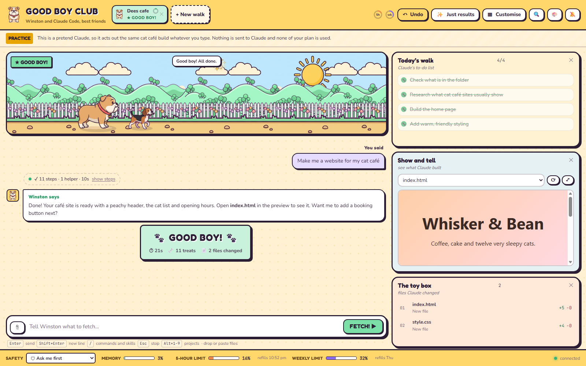
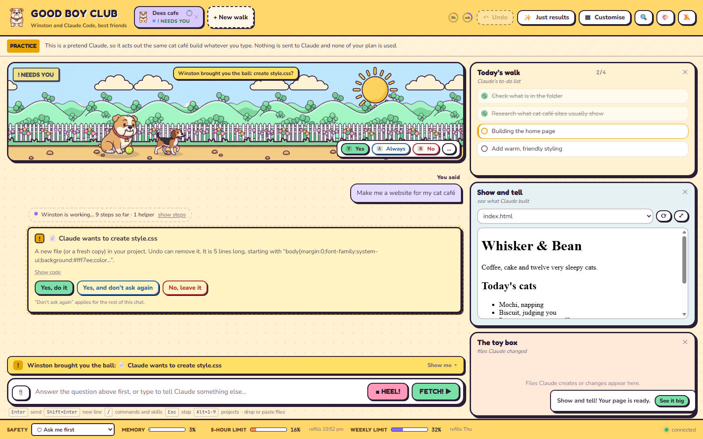
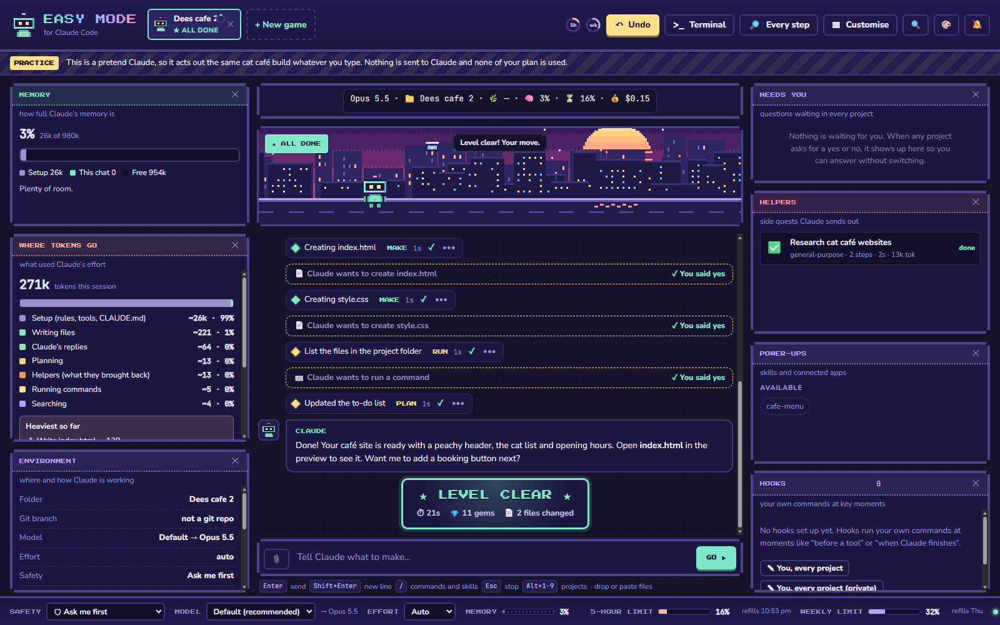
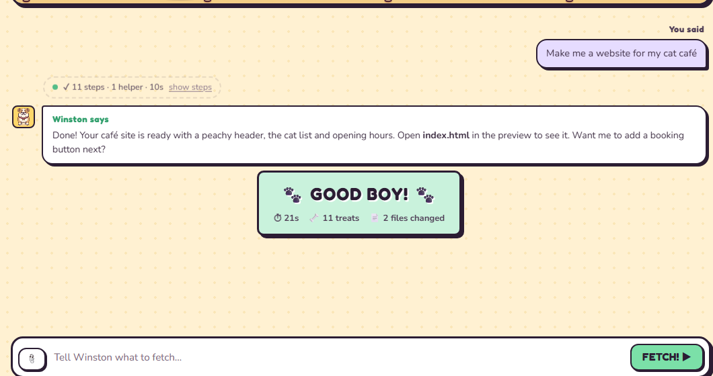
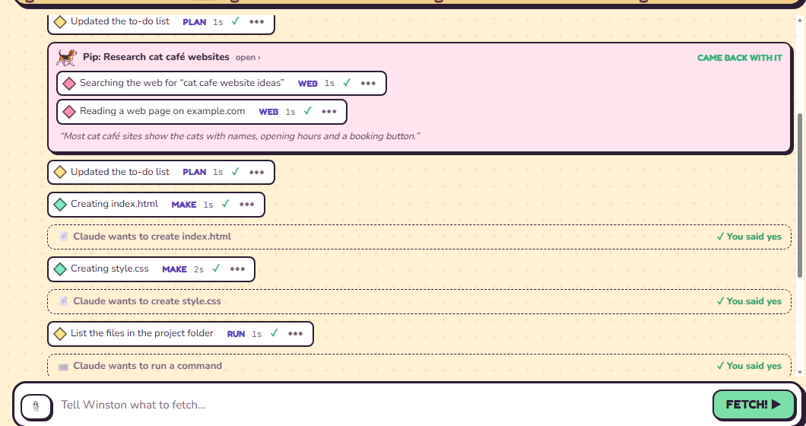
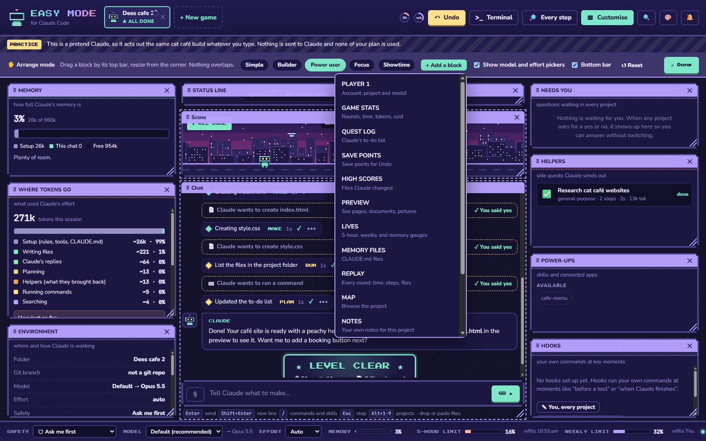
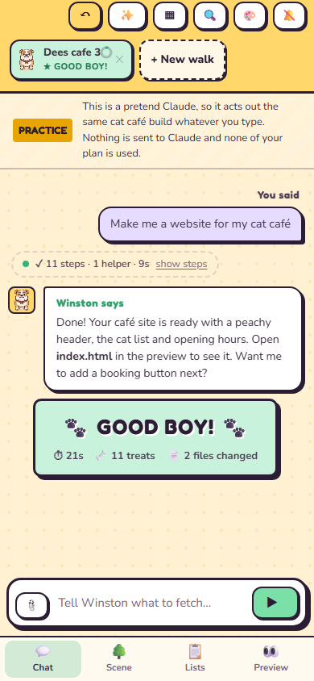

# Easy Mode for Claude Code

**The full power of the Claude Code CLI, in a friendly screen anyone can use.**

Easy Mode runs the **real Claude Code** on your own computer and shows it in a bright, calm window in your browser. You get everything the CLI can do (your Claude plan, skills, hooks, MCP servers, `CLAUDE.md`, every model and safety mode) without having to live in a black terminal window. And there's a big **Undo** button.

> **Not made by or affiliated with Anthropic.** Claude and Claude Code are trademarks of Anthropic. Easy Mode is a free, open source community project that starts the official Claude Code program on your computer. You need your own Claude account or API key.



### ▶ Watch the 80 second demo

https://github.com/user-attachments/assets/39e06eac-1236-405c-8ab8-af2baf274503

*Click the picture to play the video (`docs/media/demo.mp4`, 4.7 MB). It is recorded in practice mode with a pretend Claude.*

---

## Who it's for

People who would love the extra power of Claude Code but find the terminal overwhelming, so they stay in the Claude desktop app.

I built it with one question in mind. If my wife was asked to use Claude Code at work tomorrow, would she be fine? So the default theme stars **Winston**, our English bulldog, and his friends. A familiar face makes a new tool feel a lot less scary. If dogs aren't your thing, there's a pixel-art **Arcade Dusk** theme too.

## What it does

| Worry | What Easy Mode does |
|---|---|
| "I'll break something" | Every message makes a **save point**. **Undo** puts your files back, **Redo** brings them back again |
| Scary permission prompts | Plain-English cards like "Claude wants to create index.html. It is 36 lines long". Red warnings for deleting, installing or touching things outside your project |
| Too much going on | **Just results** hides every step and shows only the outcome. **Every step** shows everything, like the terminal does |
| "What did it make?" | **Show and tell** previews the pages, documents, spreadsheets and pictures Claude makes |
| A blank screen | Starter ideas for cafés, office work, study and coding, plus "Teach Claude about you" to write your `CLAUDE.md` |
| Missing a question | Sounds, pop-ups, the tab title and an Inbox tell you when any project needs you. Answer with **Y**, **N** or **A** |
| Downloaded projects | A folder that brings its own hooks, status line or apps asks **Trust this folder?** before any of it runs |
| Setting it up | One double-click installs everything on Windows and adds a desktop shortcut |

**Power users are covered too.** Move, resize and hide any block. Add your real status line, hooks, memory files, token breakdown, context meter, helpers (sub-agents), skills and usage limits. Use **Ctrl+K** to find anything, **Up** or **Ctrl+R** for old messages, and **Terminal** to carry the same chat into Windows Terminal and back.

| | |
|---|---|
|  |  |
| *Claude asks in plain English. You answer in the chat, the bar, the scene or the Inbox* | *Power user layout in the Arcade Dusk theme* |
|  |  |
| *Just results: one tidy line per round* | *Every step: everything Claude does* |
|  |  |
| *Customise: drag, resize, add and hide blocks* | *Works on a phone too, with tabs along the bottom* |

---

## Install on Windows (about 5 minutes)

**You need** Windows 10 or 11, an internet connection, and a Claude account (Pro, Max, Team or Enterprise) or an Anthropic API key. Setup installs the rest for you.

1. **Download.** Click the green **Code** button at the top of this page, then **Download ZIP**. (Or grab the zip from the [latest release](../../releases/latest).)
2. **Unzip it somewhere you'll keep it**, for example `Documents\Easy Mode`. Don't run it from inside the zip.
3. **Double-click `Setup Easy Mode.bat`.** A blue window opens and:
   - installs **Node.js**, **Git** and **Claude Code** using Windows' own `winget`, but only the ones you don't already have
   - adds an **Easy Mode for Claude Code** shortcut to your desktop
   - offers to sign you in to Claude (a browser window opens, this is Anthropic's normal sign-in)
   - starts Easy Mode
4. **Next time**, just double-click the desktop shortcut.

A small black window stays open while Easy Mode runs. **Close it to quit.**

> If Windows shows "Windows protected your PC", click **More info** and then **Run anyway**. The .bat files are short plain-text scripts, so you can open them in Notepad and read exactly what they do first.

### Try it first without signing in

Double-click **`Practice Easy Mode.bat`**. It uses a pretend Claude that acts out building a cat café website, so you can click everything safely. Nothing is sent to Claude and none of your plan is used.

You can also just open **`dist/easy-mode-demo.html`** in any browser for a one-file demo.

### Mac and Linux

Install [Node.js](https://nodejs.org) 18 or newer, Git and [Claude Code](https://docs.claude.com/en/docs/claude-code/setup), then in this folder run:

```
node server.js            # the real thing
npm run practice          # pretend Claude, no sign-in
```

Mac and Linux work but are less tested than Windows.

## How to use it

1. Press **+ New walk** (or **+ New game**) and pick a folder, or type a name to make a new one. Claude can only change files inside it.
2. Choose how careful Claude should be. Start with **Ask me first**.
   - 🛡 **Ask me first** asks before changing files or running anything
   - ✏️ **Edit freely** changes files on its own, asks before commands
   - 🗺 **Plan first** writes a plan and changes nothing until you say yes
   - 🤖 **Autopilot** handles safe steps and checks with you on risky ones
3. Type what you want, or tap a starter idea, and press **Fetch!** (or **Go**).
4. Say yes or no when Claude asks. Watch the to-do list and **Show and tell**.
5. Don't like it? Press **Undo**.

Handy keys: **Ctrl+K** find anything · **/** commands and skills · **Esc** stop · **Ctrl+Z** undo · **?** all shortcuts.

---

## What it does on your computer (in plain words)

* **It runs on your computer only.** A tiny web server starts on `127.0.0.1` (your own machine). Nothing is reachable from the internet or your network.
* **The only thing that talks to the internet is Claude Code itself**, the official Anthropic program, exactly as if you ran `claude` in a terminal. Easy Mode has **no analytics, no tracking and no account of its own**.
* **It never touches your Claude login.** Claude Code signs in the normal way. Easy Mode never sees your password or tokens. (Anthropic doesn't allow third-party apps to use subscription logins directly, and Easy Mode doesn't.)
* **What it saves, and where:**
  * Settings, recent projects and trusted folders: `%APPDATA%\EasyModeClaudeCode\config.json`
  * Save points for Undo: `%APPDATA%\EasyModeClaudeCode\savepoints\` (a hidden git store per project. Your own `.git` folder is never touched, and `.env` files are left out)
  * New projects you create: `%USERPROFILE%\Easy Mode Projects\`
  * Your layout, theme and notes: your browser's local storage
* **No npm packages.** The server is one file (`server.js`) using only Node's built-in parts, so there's nothing hidden to install.
* **It's all readable.** Every file is plain text. The [security notes](#security) below explain the protections.

## Uninstall

1. Delete the folder you unzipped.
2. Delete the desktop shortcut.
3. Optional: delete `%APPDATA%\EasyModeClaudeCode` (settings and save points) and `%USERPROFILE%\Easy Mode Projects` (only if you don't want those projects).

Node.js, Git and Claude Code stay installed, because other programs may use them. Remove them from Windows Settings, Apps if you like.

## Troubleshooting

| What you see | What to do |
|---|---|
| "Claude Code is not installed" | Run `Setup Easy Mode.bat` again, or open PowerShell and type `winget install Anthropic.ClaudeCode` |
| "Sign in to Claude first" | Press **Open sign in**, finish in the browser, then press **I'm signed in** |
| The page says "reconnecting" | The black window was closed. Start Easy Mode again from the shortcut |
| Your status line shows an error about `jq` | Open PowerShell and type `winget install jqlang.jq`, then restart Easy Mode |
| Undo is greyed out | Very large folders switch save points off. Use a smaller project folder |
| "Windows protected your PC" | Click **More info**, then **Run anyway** (see the install notes) |

---

## How it works (for tech people)

```
Browser page  ⇄  server.js (127.0.0.1 only)  ⇄  claude -p --input-format stream-json --output-format stream-json
```

* `server.js` has **zero npm dependencies**. It spawns the official `claude` binary per project with `--permission-prompt-tool stdio`, and relays the stream-json events to the page over Server-Sent Events.
* Permission prompts arrive as `can_use_tool` control requests and are answered with `control_response` (including `updatedPermissions` for "don't ask again", and `updatedInput.answers` for Claude's multiple-choice questions).
* `initialize` gives the app the real slash commands, skills, agents, models, effort levels and login type. `rate_limit_event` feeds the 5-hour and weekly meters.
* Mode and model changes use `set_permission_mode` and `set_model`. Effort changes restart the process with `--resume`, queued until Claude is idle.
* **Save points** live in a bare git store per project, used with `--git-dir` and `--work-tree`. Undo saves the current state first, so Undo can itself be undone (Redo).

### Security

* Listens on `127.0.0.1` only and checks the Host header (blocks DNS rebinding).
* Every action needs a random per-launch token that only the served page knows, a POST, and our own Origin.
* A project's own hooks, status line, MCP servers and env settings only load after you choose **I trust it**. Otherwise Claude starts with `--setting-sources user`. Trust is tied to a hash of those files, so any change asks again.
* The preview runs on its own port with a per-session key, refuses hidden files and links leading outside the project, and its pages can't send data anywhere (`connect-src 'self'`).
* git runs with fsmonitor and hooks switched off. Secret-looking commands are never saved into "don't ask again" rules.
* `node tools/dev/attack-check.js` re-runs 19 attacks against a throwaway server.

### Files

| File | What it is |
|---|---|
| `server.js` | The bridge to Claude Code, save points, preview server |
| `public/index.html`, `style.css` | The interface and both themes |
| `public/app.js` | Turns Claude Code events into the screen |
| `public/grid.js` | The free-form board of blocks |
| `public/skins.js` | Theme words and sounds |
| `public/world.js` | The animated scenes |
| `public/art/` | Good Boy Club cartoon art |
| `public/demo.js` | The pretend session for the one-file demo |
| `tools/fake-claude.js`, `tools/practice.js` | The pretend Claude for practice mode and testing |
| `tools/build-demo.js` | Builds `dist/easy-mode-demo.html` |
| `tools/dev/` | Automatic checks: `full.js` (about 40 checks), `demo-check.js` (24), `attack-check.js` (19), driven through headless Edge by `ui.js` |
| `setup.ps1`, `*.bat` | Windows setup, start and practice |
| `public-next/` | Working copy of the interface for development (`BYTE_RUNNER_UI=public-next`) |

## Ideas for next versions

More themes (a cosy café, a space station), showing old messages after **Continue**, a packaged `.exe`, and a theme maker. Ideas and pull requests are welcome.

## Licence and credits

MIT, see [LICENSE](LICENSE). The bundled fonts (Fredoka, Nunito, JetBrains Mono, Press Start 2P) are under the SIL Open Font License, see `public/fonts/OFL-LICENSE.txt`.

**Art.** The Good Boy Club art (Winston, the pack, Diesel and the park) was made by the project owner. Bit and the Arcade city are drawn in code. No characters from games, films or brands are used.

---

*In memory of Diesel, a fawn pug with big kind eyes. He watches over the park as a little star.* 🐾
